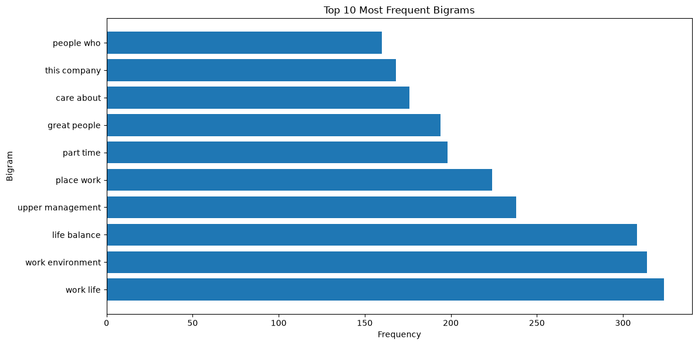

# Web Mining and Applied NLP Project Report

Web Mining and Applied NLP | Project 02 | Example Report

Author: Britany Goucher
Date: 2026 October

## Overview

This project introduces text preprocessing
as a foundation for natural language processing.

The objective is to demonstrate how raw text
can be tokenized, normalized, cleaned,
and prepared for systematic analysis.

The project compares the results of
different preprocessing operations
to show how cleaning decisions affect
the representation of text.

Custom project includes a technical modification
of the example code and addition of survey dataset
to add bigram analysis.

## Tools and Methods

The project uses:

- Python for text processing and analysis.
- Local text files for input data.
- Regular expressions for punctuation removal.
- Tokenization for separating text into words.
- Lowercasing for text normalization.
- Stopword filtering for reducing common vocabulary.
- Polars for calculating token frequencies.
- Matplotlib for visualizing preprocessing results.
- Bigram Analysis
- Logging for execution records.
- Ruff, ty, and pytest for code verification.
- Zensical and GitHub Pages for published documentation.

The example script reads text records,
combines them into a corpus,
and applies a sequence of preprocessing operations.

The analysis compares raw and cleaned token counts
and identifies frequently occurring words.

## Verification

A successful execution displays:

    Pipeline executed successfully!

The script records execution details in a project log.

The output includes token counts,
frequency distributions,
and preprocessing comparison charts.

Automated tests provide additional verification
of the project's expected behavior.

## Interpretation

Text preprocessing transforms raw language
into a representation suitable for analysis.

Lowercasing, punctuation removal,
and stopword filtering change the resulting
token distribution.

These operations can reduce unwanted noise,
but they may also remove meaningful information.

Understanding these tradeoffs is important
when preparing text for traditional NLP
and modern language-model applications.

Custom project shows an enhancement of analysis
using bigram or phrase analysis. Some of the insights
were valuable such as great people, work life, other
phrase combinations don't present as very meaningful,
such as people who, care about. Additional stop words
were added such as ice and cream to initial scrub the
analysis further;however, with such a large dataset further
scrubbing would be necessary.

## Limitations

Dataset is very large and comes from the a worldwide
population of varying companies, this likely impacts
the ability to get more granular in phrase/bigram analysis.

## Assumptions

Initially, the assumption was that bigram analysis
would be revealing in a more meaningful way; however,
it likely would be helpful to specifically apply to
isolated company survey data were domain specific
phrase knowledge or awareness could be helpful.

## Recommendations

Isolate survey data to a specific company.
Identify key phrases that are common and if
they are domain specific enough to add to the
stop words list. Recognize that including words
like people or work may limit the outputs that are
valuable such as work life.

## Custom Project Visual

## Documentation Index

- **Home** - this landing page
- [**Project Instructions**](project-instructions.md)
- [**Glossary**](glossary.md)

## Project Links

- [GitHub Repository](https://github.com/denisecase/nlp-02-text-preprocessing)
- [Example Script](https://github.com/denisecase/nlp-02-text-preprocessing/blob/main/src/nlp/text_preprocessing.py)
- [Example Notebook](https://github.com/denisecase/nlp-02-text-preprocessing/blob/main/notebooks/text_preprocessing.ipynb)
- [Example Data](https://github.com/denisecase/nlp-02-text-preprocessing/blob/main/data/text_data.txt)

## Project Resources

- [Project Instructions](project-instructions.md)
- [Professional Python Guide](https://denisecase.github.io/pro-analytics-02/)
- [Professional Python Project Explainer](https://pup-pack.github.io/professional-python-project-explainer/)
